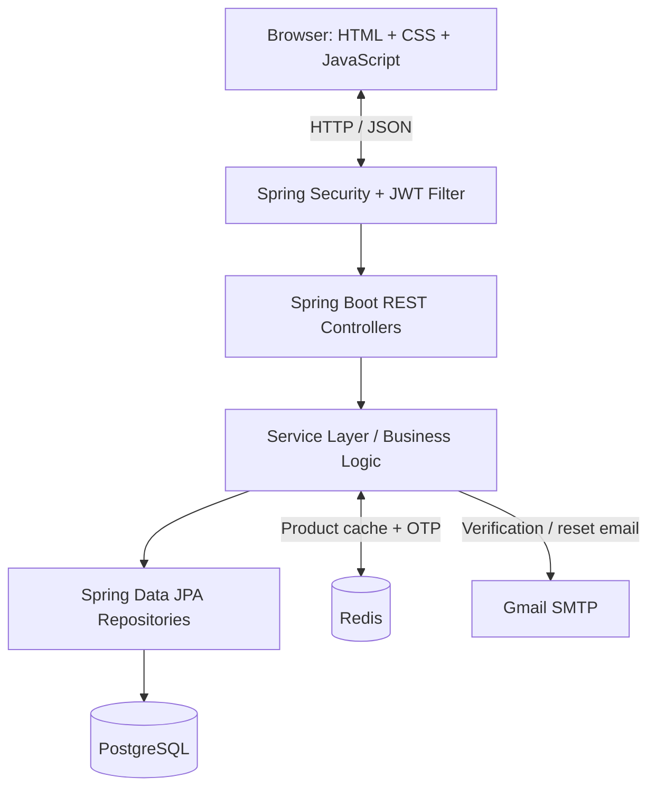
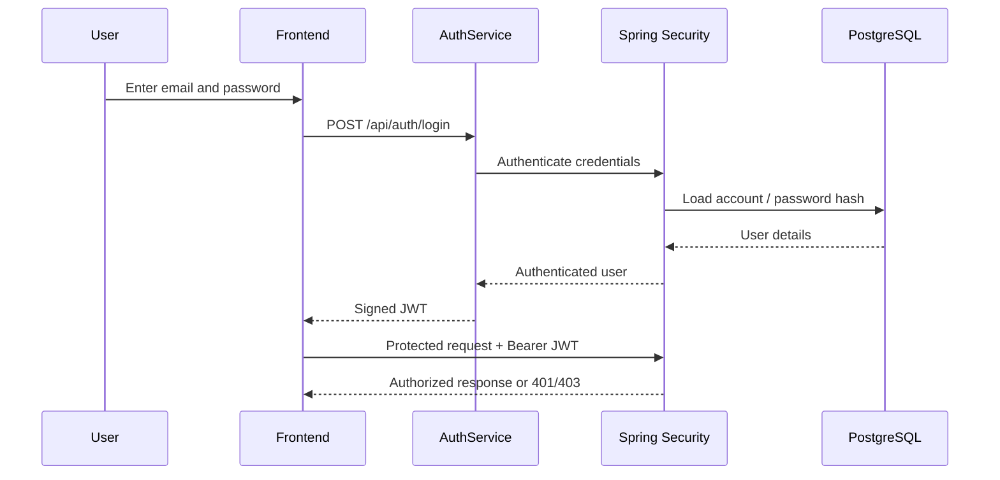
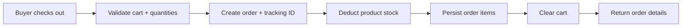
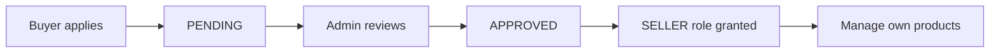

<div align="center">

# 🛍️ ShopSphere

### Full-Stack E-Commerce & Marketplace Management System

A responsive online marketplace with buyer, seller, and administrator workflows, built with **Java 21, Spring Boot, PostgreSQL, Redis, HTML, CSS, and JavaScript**.

[Features](#-features) · [Tech Stack](#-tech-stack) · [Getting Started](#-getting-started) · [API Reference](#-api-overview) · [Architecture](#-architecture) · [Future Improvements](#-limitations--future-improvements)

</div>

---

## 📖 Overview

**ShopSphere** is a full-stack e-commerce application developed as a college project to demonstrate the core functionality of an online marketplace. It provides product discovery, customer accounts, shopping carts, order management, seller onboarding, inventory management, and administrative moderation.

The project follows a **modular monolithic architecture**: a Spring Boot application serves the REST API and the plain HTML/CSS/JavaScript frontend. **PostgreSQL** stores persistent data, while **Redis** is used for time-limited OTP storage and product-detail caching.

### User roles

| Role | Capabilities |
| --- | --- |
| **Buyer** | Register, verify email, browse/search products, manage addresses and cart, checkout, track orders, request returns, and review delivered purchases. |
| **Seller** | Apply for seller access, manage owned products after approval, and view store metrics and recent orders. |
| **Admin** | Approve seller applications, suspend sellers/products, and browse/filter user accounts. |

> **Note:** New accounts start with the `BUYER` role. Becoming a seller requires administrator approval. The frontend hides role-specific navigation, but authorization is enforced on the backend.

## ✨ Features

### 🛒 Customer experience

- Responsive storefront with promotional hero banners and category navigation.
- Product search by name, brand, and description; live search suggestions.
- Client-side category, availability, price, and sorting filters with catalog pagination.
- Product details, images, ratings, and customer reviews.
- User registration, login, profile viewing/editing, and email verification.
- Email OTP verification and password reset with Redis-backed, expiring codes.
- Saved delivery addresses, including a default address.
- Shopping cart: add items, update quantities, remove items, and review totals.
- Cash-on-delivery checkout, order history, tracking numbers, order cancellation, and return requests.
- Reviews restricted to products purchased in delivered orders.

### 🏪 Seller experience

- Seller application workflow with `PENDING`, `APPROVED`, and `SUSPENDED` states.
- Product creation, editing, and deletion, restricted to approved sellers.
- Ownership checks prevent one seller from modifying another seller's listings.
- Seller dashboard reporting orders, items sold, **delivered-order revenue**, product count, ratings, and recent orders.

### 🛡️ Administration

- Review and approve pending seller applications.
- Suspend sellers and products, with suspension reasons.
- Paginated user directory with role, age, and gender filters.
- Spring Security role-based access control for protected operations.

### ⚙️ Backend capabilities

- RESTful APIs using Spring MVC controllers and request/response DTOs.
- Password hashing using BCrypt; signed JWT access tokens (30-minute lifetime).
- Spring Data JPA / Hibernate entities and repositories with PostgreSQL.
- Transactional order placement and inventory updates.
- Redis caching of product details (10-minute TTL) and hashed OTPs (5-minute TTL).
- Centralized API exception handling and Bean Validation.
- Swagger / OpenAPI documentation at `/docs`.


## 🧰 Tech Stack

| Layer | Technologies |
| --- | --- |
| Frontend | HTML5, CSS3, vanilla JavaScript (Fetch API, DOM manipulation, responsive layouts) |
| Backend | Java 21, Spring Boot 4.1.2, Spring MVC |
| Authentication | Spring Security, JJWT 0.12.6, BCrypt |
| Persistence | Spring Data JPA, Hibernate, PostgreSQL |
| Cache & OTP | Redis, Spring Data Redis, `StringRedisTemplate` |
| Email | Spring Mail, Gmail SMTP |
| Validation & API docs | Jakarta Bean Validation, springdoc OpenAPI / Swagger UI |
| Build & utilities | Maven Wrapper, Lombok |
| Testing dependencies | JUnit / Spring Boot Test, H2 |

> A Spring AI / Ollama dependency is present in `pom.xml`, but the current repository does **not** implement an AI-powered shopping feature.

## 🏗️ Architecture



### Repository layout

```text
src/
├── main/
│   ├── java/com/example/e_commerce/
│   │   ├── admin/       # Admin endpoints, services, and DTOs
│   │   ├── cart/        # Cart and cart-item operations
│   │   ├── common/      # JWT filter, security, Redis, OpenAPI, exceptions
│   │   ├── order/       # Orders, tracking, returns, reviews, analytics
│   │   ├── product/     # Product catalog, seller management, caching
│   │   └── user/        # Authentication, OTP, profiles, addresses, sellers
│   └── resources/
│       ├── application.properties
│       └── static/
│           ├── index.html
│           ├── css/styles.css
│           └── js/app.js
└── test/                  # Spring Boot application context test
pom.xml
mvnw / mvnw.cmd
```

### Backend layering

```text
HTTP Request
   ↓
Controller  → parses request and returns an HTTP response
   ↓
Service     → validates business rules and handles transactions
   ↓
Repository  → reads/writes database entities through JPA
   ↓
PostgreSQL
```

**DTOs** define request/response contracts; **mappers** convert between DTOs and JPA entities. The application uses UUIDs for most resource identifiers.

## 🚀 Getting Started

### Prerequisites

- **JDK 21**
- **PostgreSQL** with a database for ShopSphere
- **Redis** running locally or on an accessible host
- **Gmail SMTP credentials** (typically a Gmail app password) for OTP emails
- **Git** and a terminal; Maven is included through the Maven Wrapper

### 1. Clone the repository

```bash
git clone https://github.com/tanmaysaxena1987-dev/e-commerce.git
cd e-commerce
```

### 2. Create the database

In `psql` or pgAdmin, run:

```sql
CREATE DATABASE ecommerce;
```

Adjust the database name in your configuration if you choose a different one.

### 3. Start Redis

If Docker is installed:

```bash
docker run -d --name shopsphere-redis -p 6379:6379 redis:7-alpine
```

Alternatively, start an existing Redis server and use its host/port below.

### 4. Configure local environment

Create a file named **`.env`** in the project root (the repository already ignores this file). The application imports it as Java properties:

```properties
DB_URL=jdbc:postgresql://localhost:5432/ecommerce
DB_USERNAME=postgres
DB_PASSWORD=YOUR_DATABASE_PASSWORD

REDIS_HOST=localhost
REDIS_PORT=6379

MAIL_USERNAME=your-email@gmail.com
MAIL_PASSWORD=YOUR_GMAIL_APP_PASSWORD

JWT_SECRET=YOUR_BASE64_ENCODED_RANDOM_SECRET
```

**Generate a JWT secret:** `JwtConfig` expects a Base64-encoded HMAC key, not an arbitrary text password. For example, in Windows PowerShell:

```powershell
$bytes = New-Object byte[] 32
[System.Security.Cryptography.RandomNumberGenerator]::Create().GetBytes($bytes)
[Convert]::ToBase64String($bytes)
```

Copy the generated Base64 value into `JWT_SECRET`. Use your own credentials, never commit `.env`, and never share real secrets in issues or screenshots.

> **Security note:** Admin registration currently has a fallback registration secret in its configuration. Replace that approach with a secure deployment-provided secret or controlled admin provisioning before exposing the application publicly.

### 5. Start the application

**Windows PowerShell**

```powershell
.\mvnw.cmd spring-boot:run
```

**macOS / Linux**

```bash
./mvnw spring-boot:run
```

Open the following URLs:

| Service | Local URL |
| --- | --- |
| ShopSphere frontend | http://localhost:8081/ |
| Swagger API documentation | http://localhost:8081/docs |
| Example public search | http://localhost:8081/api/product/search?keyword=mouse |

The backend serves the frontend directly from `src/main/resources/static/`; **there is no separate frontend build step**.

### 6. Build and test

```powershell
# Windows
.\mvnw.cmd clean test
.\mvnw.cmd clean package
```

```bash
# macOS / Linux
./mvnw clean test
./mvnw clean package
```

> The repository currently includes a Spring Boot application context test. Comprehensive automated service and API tests are future work.

## 🔌 API Overview

API paths below are relative to `http://localhost:8081`. Protected endpoints require:

```http
Authorization: Bearer <JWT_ACCESS_TOKEN>
```

### Authentication and user profile

| Method | Path | Description |
| --- | --- | --- |
| `POST` | `/api/user/register` | Register a buyer |
| `POST` | `/api/auth/login` | Login and receive a JWT |
| `POST` | `/api/auth/forgot-password?email=...` | Request password-reset OTP |
| `POST` | `/api/auth/reset-password` | Verify reset OTP and set a new password |
| `GET` | `/api/user/email-verification` | Email a verification OTP (authenticated) |
| `POST` | `/api/user/verify-otp` | Verify email with OTP |
| `GET` | `/api/user/email-status` | Return email verification status as a boolean |
| `GET` | `/api/user/me` | Read current user profile |
| `PUT` | `/api/user/me` | Update current user profile |
| `GET` | `/api/user/addresses` | List saved buyer addresses |
| `POST` | `/api/user/addresses` | Add an address |
| `PUT` | `/api/user/addresses/{addressId}` | Update an address |
| `DELETE` | `/api/user/addresses/{addressId}` | Delete an address |

### Products, seller accounts, and shopping cart

| Method | Path | Description |
| --- | --- | --- |
| `GET` | `/api/product/search?keyword=...` | Search product catalog |
| `GET` | `/api/products/{productId}` | Get product details (Redis-cached) |
| `POST` | `/api/seller/become` | Apply to become a seller |
| `GET` | `/api/seller/me` | View seller application status |
| `POST` | `/api/product` | Create a product (approved seller) |
| `PUT` | `/api/product/{productId}` | Update owned product |
| `DELETE` | `/api/product/{productId}` | Delete owned product |
| `GET` | `/api/cart` | View cart |
| `POST` | `/api/cart` | Add product to cart |
| `PUT` | `/api/cart/{productId}` | Change cart item quantity |
| `DELETE` | `/api/cart/{productId}` | Remove product from cart |
| `GET` | `/api/cart/items` | List cart items with pagination |

### Orders and reviews

| Method | Path | Description |
| --- | --- | --- |
| `POST` | `/api/orders` | Place order from the current cart |
| `GET` | `/api/orders` | Paginated order history |
| `GET` | `/api/orders/status/{status}` | Filter orders by status |
| `GET` | `/api/orders/{orderId}` | View an order |
| `GET` | `/api/orders/{orderId}/track` | Track an order by ID |
| `GET` | `/api/orders/track/{trackingNumber}` | Track by tracking number |
| `PUT` | `/api/orders/{orderId}/cancel` | Cancel an eligible order |
| `PUT` | `/api/orders/{orderId}/return` | Request return of a delivered order |
| `POST` | `/api/orders/items/{orderItemId}/review` | Review a delivered purchase |
| `GET` | `/api/orders/seller/summary` | Seller metrics and recent orders |

### Administration

| Method | Path | Description |
| --- | --- | --- |
| `POST` | `/api/admin/register` | Admin registration (requires secret) |
| `GET` | `/api/admin/sellers/pending` | Pending seller applications |
| `PUT` | `/api/admin/seller/{sellerId}/approve` | Approve seller |
| `PUT` | `/api/admin/seller/{sellerId}/suspend` | Suspend seller |
| `PUT` | `/api/admin/product/{productId}/suspend` | Suspend product |
| `GET` | `/api/admin/users` | Paginated user list and filters |

### Sample requests

**Create a product (approved seller):**

```http
POST /api/product
Authorization: Bearer <SELLER_TOKEN>
Content-Type: application/json

{
  "name": "Wireless Mouse",
  "description": "Ergonomic wireless mouse",
  "brand": "Example Brand",
  "price": 799.00,
  "category": "ELECTRONICS",
  "stockQuantity": 20,
  "imageUrl": "https://example.com/mouse.jpg"
}
```

**Place an order (buyer with items in their cart):**

```http
POST /api/orders
Authorization: Bearer <BUYER_TOKEN>
Content-Type: application/json

{
  "paymentMethod": "CASH_ON_DELIVERY",
  "shippingAddress": "123 Example Street",
  "city": "Kota",
  "state": "Rajasthan",
  "zipCode": "324005",
  "country": "India",
  "phoneNumber": "+919876543210",
  "shippingCost": 0,
  "deliveryNotes": "Please call before delivery"
}
```

## 🔄 Key Workflows

### Login and authorization



### Order placement



Order creation runs inside a database transaction. Cancellation of an eligible order restores stock; delivered orders can have return requests and post-delivery reviews.

### Seller onboarding



## 🗃️ Data Model (Simplified)

- **User**: account, role, hashed password, verification status, profile fields.
- **Seller**: store information, approval status, linked one-to-one to a user through `@MapsId`.
- **Admin**: administrative profile linked one-to-one to a user.
- **Address**: shipping addresses associated with a user.
- **Product**: listing information, seller ID, price, stock, availability status, rating summary.
- **Cart / CartItem**: user's selected products and quantities.
- **Order / OrderItem**: submitted purchase, delivery information, tracking number, prices, and quantities.
- **Review**: rating/comment associated with a delivered order item, product, and user.

Spring Data JPA handles relationships and persistence; the application uses PostgreSQL as its source of truth for permanent records.

## 🛡️ Security Notes

- Passwords are stored as **BCrypt hashes**; never store plaintext passwords.
- JWT access tokens are signed and validated by a custom filter; protected endpoints use `Authorization: Bearer ...`.
- The seller product service enforces **seller approval and product ownership**; admin actions require administrator authorization.
- OTP hashes have a five-minute Redis TTL and are deleted after successful verification.
- The frontend shows an OTP resend cooldown, but **frontend-only cooldowns are not server-side rate limiting**.
- The current frontend stores JWTs in `localStorage`; consider an improved session strategy for production use.
- Avoid publishing secrets or real customer information. Review the admin registration secret fallback before public deployment.

## 📌 Limitations & Future Improvements

This repository is a **college full-stack project**, not a fully production-ready commerce platform.

- **Payments:** Checkout currently offers cash on delivery; it does not process actual online payments.
- **Discounts:** The frontend can display original-price discounts when available, but the current `Product` entity and DTO do not persist a `compareAtPrice` field.
- **Inventory consistency:** Stock is updated when orders are created/cancelled; stronger locking/concurrency controls and stock-status synchronization are recommended.
- **Product caching:** Redis is invalidated on product updates and during checkout/cancellation; production-grade cache invalidation should happen after successful database commits.
- **Search:** Backend product search uses a JPQL partial match; category/price filters and storefront pagination currently operate in JavaScript after loading the catalog.
- **OTP security:** Add server-side rate limiting, attempt caps, and safer handling for missing/expired OTP hashes.
- **Order fulfillment:** Tracking numbers and statuses are stored in the application; there is no third-party shipping carrier integration.
- **Testing:** Extend the existing context-loading test with service, controller, repository, and end-to-end tests.
- **Operations:** Add database migrations, production logging profiles, monitoring, and CI/CD.

## 👥 Project Team

This repository was prepared as a college lab project. Add your group members and accurately describe the work each person contributed, such as implementation, design, validation, testing, presentation, or documentation.

| Member | GitHub | Contribution |
| --- | --- | --- |
| *Add name* | *Add profile* | *Describe contribution* |
| *Add name* | *Add profile* | *Describe contribution* |
| *Add name* | *Add profile* | *Describe contribution* |

## 📚 Project Links

- **Repository:** https://github.com/tanmaysaxena1987-dev/e-commerce
- **API documentation (locally):** http://localhost:8081/docs

---

<div align="center">

**ShopSphere** — a practical exploration of full-stack web development, REST APIs, secure authentication, relational persistence, and caching.

</div>
